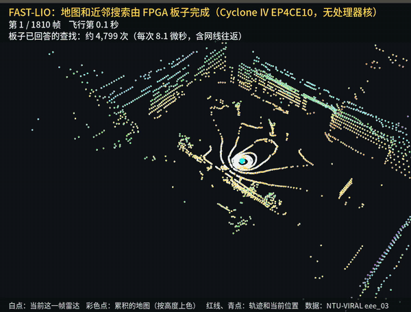

# fastlio-fpga

**在一块入门级 FPGA 上跑 FAST-LIO 最重的一步：地图放进板载 SDRAM，近邻搜索全部由 FPGA 完成，逐位验证，定位精度与原版一致。**

*FAST-LIO's heaviest step on a ~$76 entry-level FPGA board (Cyclone IV EP4CE10, no CPU core): the map lives in the
on-board 32 MB SDRAM and the FPGA answers every nearest-neighbour query, bit-exact against a golden model, with the
same trajectory accuracy as the original.*



*上图：NTU-VIRAL eee_03 整段 1810 帧（约 3 倍速抽帧）。FAST-LIO 运行时每一次近邻查找都发给板子，共约 1192 万次、0 次超时；
彩色点是累积的地图（按高度上色），白点是当前帧，红线是算出的轨迹。画面由 RViz 离线逐帧渲染（`eval/video/`），
数据来自 FAST-LIO 的 `FPGA_VIZ_DUMP` 钩子；该数据集世界系 z 轴朝下，渲染时已翻正。*

硬件：野火 征途Pro（Altera Cyclone IV EP4CE10F17C8，10,320 逻辑单元，32 MB SDRAM，百兆网口，无 ARM）。
电脑跑 FAST-LIO 其余部分（ROS 2 Humble），经百兆网口 UDP 与板子通信。

## 实测结果

数据：[NTU-VIRAL](https://ntu-aris.github.io/ntu_viral_dataset/) eee_03（Ouster OS1-16 + VN100，1810 帧，全程 127.8 m），
轨迹误差按 Leica 棱镜真值对齐计算。

| FAST-LIO 运行方式 | ATE RMSE |
|---|---|
| 原版（ikd-tree，CPU），两次运行 | 11.62 / 11.61 cm |
| 原版（另一台机器，WSL） | 11.57 cm |
| 地图 + 近邻搜索在 FPGA 上（v1） | **11.31 cm** |
| 地图 + 近邻搜索在 FPGA 上（v2） | **11.40 cm** |
| HᵀH 累加在 FPGA 上 | **11.63 cm** |

同样设置跑两次原版，轨迹之间最大相差 4.8 cm（FAST-LIO 多线程本身不确定），上表各项都在这个范围内。

| 指标 | v1 | v2（摘要 + 指纹布局） |
|---|---|---|
| 每次近邻查找（含电脑↔板子网络往返，整段平均） | 18.9 μs | **11.4 μs** |
| 每帧近邻搜索 + 加点（约 6600 次查找） | ≈ 127 ms | **≈ 77 ms**（10 Hz 雷达预算 100 ms） |
| 逻辑单元 / 100 MHz 时序余量 | 7,311（71 %）/ +0.09 ns | 7,048（68 %）/ +0.22 ns |
| 整段闭环（1810 帧） | 96.9 万次加点、1192 万次查找，0 超时 | 97.5 万次加点、1192 万次查找，0 超时 |

**忘掉远处**（地图不再只进不出）：一组 8 个槽都被占时，读出 8 个标签，腾出离新体素最远的那一格（切比雪夫距离大于保留半径才腾，
否则丢掉这次加点）。保留半径和表大小随清图命令下发，板子可回报自己的丢点数和遗忘数。7,456 逻辑单元（72 %），100 MHz 余量 +0.13 ns。

| 真板子闭环（1810 帧，0 超时） | 板子遗忘 | 板子丢点 | 每次查找（含网络） | ATE |
|---|---|---|---|---|
| 故意缩小到 4 MB 表，保留 60 m | 62,818 | 21,316 | 11.28 μs | **11.36 cm** |
| 16 MB 表，保留 200 m（默认） | 0 | 24 | 11.30 μs | **11.42 cm** |

同样 4 MB 表不开遗忘（软件模型）丢 105,158 次加点，开了丢 18,954 次。这段数据只有 128 m，地图大小对精度几乎没有影响
（2 MB 表丢 68 万次加点，ATE 仍是 11.42 cm），所以这里只能说明“功能正确、不伤精度、丢点变少”，不能说明“更准”。

逐位验证：
- 近邻搜索：Python 标准答案与 FAST-LIO 内的 C++ 实现在整段数据上逐条一致（968,641 次加点、11,965,621 次查找）；
  RTL 在仿真（Micron SDRAM 模型）和上板时，对真实 FAST-LIO 操作与人造压力测试的结果都与标准答案逐位相同。
  带遗忘的规则同样核对过：C++ 与 Python 整段一致（1,037,766 次加点、11,965,432 次查找，其中遗忘 60,151 格）；
  RTL 仿真与上板在遗忘压力测试（3153 次查找）和真实操作（500 次查找）上逐位相同，板子计数与标准答案相等；板端关掉遗忘的反向对照会失败。
- HᵀH：FAST-LIO 实际做的 7,069 次迭代，板子 7,069/7,069 逐位一致。

**要说清楚的地方**：电脑现在仍在跑 FAST-LIO 的其余部分（预处理、滤波更新、拟合平面）。这一步在台式机 16 线程上
约 17.8 ms/帧，比这块板子快；本项目的意义是“在最便宜、没有 CPU 核的 FPGA 上把最重的一步做对、做完整验证”，不是加速。

## 结构

```
LiDAR + IMU ──> PC: FAST-LIO (预处理 / IEKF / 拟合平面)
                     │  UDP, 百兆               ▲
                     ▼                           │ 最近 5 点
               征途Pro FPGA ── nn_engine ── nn_core ── sdram_rw ── 32 MB SDRAM（体素哈希地图）
```

- `nn/`：地图与近邻搜索。0.5 m 体素，2^16 组 × 8 路，乘法哈希；每组 128 字放在 SDRAM 同一行；
  v2 先读 6 字摘要（点数 + 8 位指纹），指纹对上才读标签和点。设计与全部实验记录见 [nn/DESIGN.md](nn/DESIGN.md)。
- `hth/`：HᵀH / Hᵀh 累加引擎，单乘法器 54 条微码/点，80 位精确累加。见 [hth/SPEC.md](hth/SPEC.md)、[hth/RESULTS.md](hth/RESULTS.md)。
- `fastlio_patch/`：FAST-LIO 补丁（`FPGA_NN_MODE=voxel|voxfx|fpga`、`FPGA_NN_KEEP`（保留半径，米，默认 200）、`FPGA_HTH_MODE=cpu|fixed|fpga`、录制与轨迹输出）。
- `ethernet/`：以太网 UDP 收发（基于野火例程修改，见下）。
- `common/`：双时钟 FIFO、测试用以太网帧构造工具。`eval/`：ATE 计算与回放脚本；`eval/video/`：把 `FPGA_VIZ_DUMP` 录下的每帧点云和位姿离线渲染成视频（虚拟显示器里的 RViz 逐帧截图）。

## 过程中找到并修掉的问题

| 问题 | 怎么发现 | 修法 |
|---|---|---|
| 野火以太网例程收包状态机在帧间不复位：外来广播帧停在半路，下一帧前导码被数错 → 每轮开头丢包 | 板上加收包计数器（帧开始 / 前导码通过 / 收下），仿真复现 | 帧间强制回 IDLE、清计数 |
| 发送忙时新的“开始发送”被忽略 → 多包在途时丢回包 | 闭环中出现，仿真用 4 包在途复现（旧 72/73，新 73/73） | 发送排队 |
| 回包长度晚一拍 | 整机仿真 | 直接连线 |
| SDRAM 请求与刷新撞车时丢失 | 代码审查 | req/ack 握手 |
| SDRAM 上电内容随机，所有槽看似已占用 | 仿真（全部加点被丢） | 启动清表 |
| 低位异或哈希在“薄壳”地图上冲突严重（丢 145 万次加点） | 软件模型统计 | 乘法哈希 + 8 路分组（只丢 35 次） |
| FAST-LIO 雷达订阅 SensorDataQoS（深度 5）回放时丢 2/3 帧 | 轨迹只有 658/1814 帧 | 可靠传输、深度 200 |
| 100 MHz 时序差 9.5 ns | TimeQuest | 拆流水、收窄位宽、移位代替常数乘除 |

## 复现

需要：Quartus II 13.0 SP1（Web Edition）、iverilog 12、Python 3 + numpy、ROS 2 Humble、
FAST-LIO ROS 2 分支 commit `cc3c9e8`。

```bash
# 1. 以太网收发文件（从野火 GitHub 下载并打补丁）
bash ethernet/fetch_embedfire_eth.sh

# 2. 仿真：命令见 hth/sim/README.md、nn/sim/README.md（Micron SDRAM 模型需自行下载）

# 3. 综合：Quartus 打开 nn/quartus_prj/lio_nn.qpf 或 hth/quartus_prj/lio_hth.qpf，编译后用 USB-Blaster 下载

# 4. FAST-LIO
cd <你的 FAST_LIO 目录> && git checkout cc3c9e8 && git apply <本仓库>/fastlio_patch/fast_lio_fpga.patch
colcon build --packages-select fast_lio
FPGA_NN_MODE=fpga FPGA_HTH_TRAJ=traj.tum ros2 run fast_lio fastlio_mapping --ros-args --params-file config/ntu_viral.yaml
```

板子地址 192.168.137.234:1234（UDP，回信发给寄信人）。板子不应答 ARP，电脑上需要一条静态 ARP：
`ip neigh replace 192.168.137.234 lladdr 12:34:56:78:9a:bc dev <网口>`（Windows 用 `New-NetNeighbor`）。
WSL2 的 MTU 是 1200，所以每个 UDP 包不超过 1172 字节（查找包最多 18 次查找）。

## 许可

- 本项目自己写的文件：MIT（见 [LICENSE](LICENSE)）。
- `fastlio_patch/`：FAST-LIO 的修改，按 GPL-2.0（与 FAST-LIO 相同）。
- 以太网收发基于野火《FPGA Verilog 开发实战指南——基于 Altera EP4CE10》配套代码例程 60_ethernet_udp_rmii
  （[Embedfire-altera/ebf_ep4ce10_pro_tutorial_code](https://github.com/Embedfire-altera/ebf_ep4ce10_pro_tutorial_code)）。
  原仓库没有许可证说明，因此本仓库只提供下载脚本和补丁，不包含原文件。
- Micron SDRAM 仿真模型版权归 Micron，请自行下载。

## 致谢

[FAST-LIO](https://github.com/hku-mars/FAST_LIO)（HKU MARS）、野火电子教程代码、NTU-VIRAL 数据集、Micron SDRAM 模型。

作者：A Gudamu（阿古大目）
